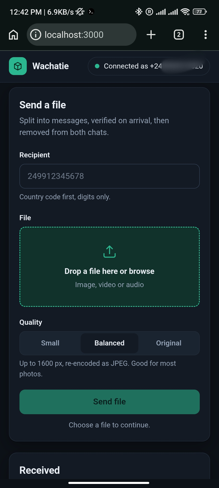
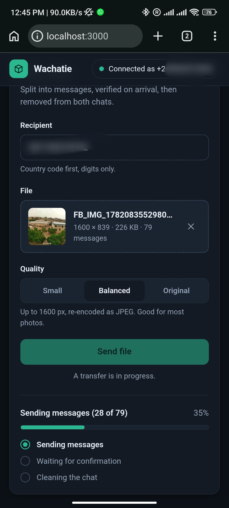
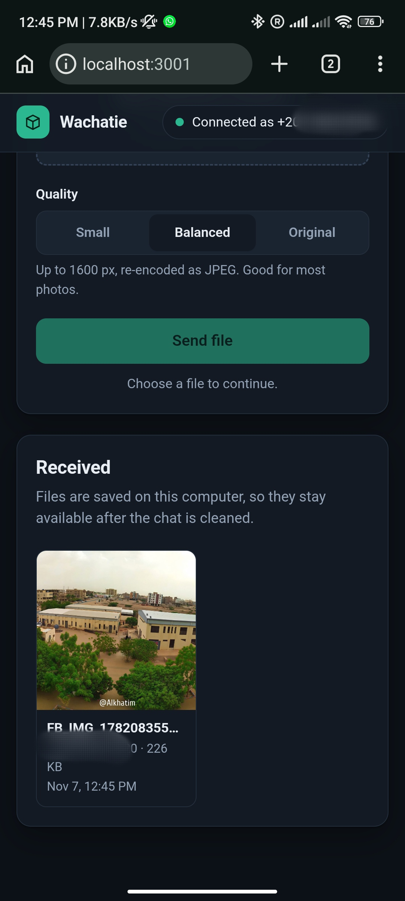

# Wachatie

Send images, video and audio between two WhatsApp accounts as a series of text messages. The receiver reassembles the chunks, verifies them, saves the file locally, and both sides then remove the transfer messages from their own chats. Nothing is deleted for the other person, so no "this message was deleted" placeholders are left behind.

## Screenshots

  
  

## Requirements

- Node.js 20 or newer
- A WhatsApp account on each end, each running its own copy of Wachatie

## Run

    git clone https://github.com/AlkhatimMuhammed/wachatie.git
    cd wachatie
    npm install
    npm start

Open http://localhost:3000. On the first run the page asks for your phone number and shows a pairing code. On your phone go to WhatsApp, Settings, Linked devices, Link a device, Link with phone number instead, and enter the code. The session is stored in `data/auth` and reused on the next start. Keep that folder private.

## Supported files

- Images: JPEG, PNG, WebP, GIF. Resized in the browser before sending unless Original is selected.
- Video: MP4, MOV, WebM
- Audio: MP3, M4A, AAC, OGG, WAV, FLAC

Video and audio are sent as they are, without re-encoding.

## How a transfer works

1. The browser prepares the file and sends it to the local server.
2. The server splits it into text messages: one metadata message with the size and SHA-256 hash, followed by the data chunks.
3. The receiver collects the chunks in any order, asks for missing parts if the transfer stalls, and verifies size, hash and file type.
4. The file is written to `data/received` before anything is cleaned up.
5. The receiver sends a confirmation message. Each side then removes the transfer messages from its own chat using WhatsApp's "delete for me", including the confirmation message itself.

Because the cleanup is local to each account, it also syncs to the phone linked to that account.

## Configuration

All settings are optional environment variables.

| Variable | Default | Description |
| --- | --- | --- |
| `PORT` | `3000` | HTTP port |
| `HOST` | `127.0.0.1` | Interface to bind. Keep the default unless you know you need more |
| `ALLOWED_HOSTS` | | Extra host names accepted in the `Host` header when `HOST` is changed |
| `DATA_DIR` | `./data` | Session and received files |
| `CHUNK_SIZE` | `4000` | Characters per data message |
| `SEND_INTERVAL_MS` | `200` | Pause between messages |
| `MAX_IMAGE_BYTES` | `2097152` | Largest image accepted, after resizing |
| `MAX_MEDIA_BYTES` | `5242880` | Largest video or audio file accepted |
| `ACK_TIMEOUT_MS` | `600000` | How long the sender waits for the confirmation |
| `STALL_TIMEOUT_MS` | `20000` | Idle time before the receiver asks for missing parts |
| `MAX_RESEND_ROUNDS` | `5` | Resend requests before the receiver gives up |
| `MAX_INCOMING_TRANSFERS` | `4` | Concurrent incoming transfers |
| `ALLOWED_SENDERS` | | Comma-separated numbers allowed to send to you. Empty accepts everyone |
| `PAIRING_PHONE` | | Request a pairing code at startup instead of using the page |
| `LOG_LEVEL` | `info` | `debug`, `info`, `warn`, `error` or `silent` |

Example:

    ALLOWED_SENDERS=249912345678 SEND_INTERVAL_MS=300 npm start

## Security notes

- The server listens on localhost only and rejects requests with an unexpected `Host` or `Origin` header.
- Anyone who can open the page can send messages as the linked account, so do not expose the port.
- Received data is accepted only if the declared size, hash and file signature all match. SVG is not accepted.
- Set `ALLOWED_SENDERS` if you do not want unknown contacts to push files to your machine.
- Never commit or share the `data` folder. It contains your WhatsApp session.

## Limits

- Wachatie uses an unofficial WhatsApp Web library. WhatsApp may restrict accounts that send many automated messages, so keep files small and use a spare account if the account matters to you.
- A 200 KB file is roughly 70 messages at the default chunk size.
- If cleanup cannot complete (for example the phone has not synced its app-state keys yet), the file is still delivered and the interface says that some messages remain.

## Tests

    npm test

The suite covers the wire protocol, the transfer engine over a simulated lossy network (drops, reordering, duplicates, tampering, timeouts), file type detection, and the HTTP and socket layer.

## License

Copyright (c) 2026 Alkhatim Muhammed. All rights reserved. See the LICENSE file. Contact: alkhatimmuhammed@gmail.com
